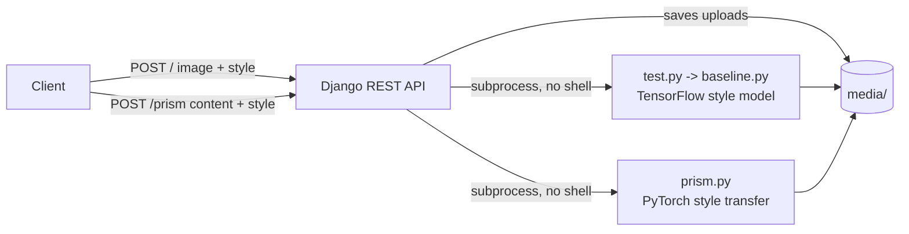

# Deep-World

[](https://github.com/a-3isa/Deep-World/actions/workflows/ci.yml)

A Django REST API that applies image effects with neural networks: DeepDream-style transformations and artistic style transfer.

## Architecture



## Endpoints

- `POST /` multipart: `image` (file), `style` (a model name: letters, digits, `-` and `_`; the model is `models/<style>.pb`). Runs the DeepDream script on the upload and returns the result URL.
- `POST /prism` multipart: `content` (file), `style` (file). Runs neural style transfer with Prism and returns the result URL.

Both responses look like `{ "result": "http://<host>:<port>/<file>" }`.

## Credits

Style transfer uses [Prism](https://github.com/moritztng/prism) by Moritz Thuening (MIT). `style_transfer/` is derived from it.

## Setup

Prerequisites: Python 3.7+, optionally a CUDA GPU.

```bash
git clone https://github.com/a-3isa/Deep-World
cd Deep-World
pip install -r requirements-api.txt   # the API
pip install tensorflow torch          # the image scripts
cp .env.example .env                  # then export the values: DJANGO_SECRET_KEY is required
python manage.py migrate
python manage.py runserver 0.0.0.0:599
```

| Variable | Required | Purpose |
|---|---|---|
| `DJANGO_SECRET_KEY` | yes | Django's signing key; the server will not start without it |
| `DJANGO_DEBUG` | no | `1` turns on debug mode (development only) |
| `DJANGO_ALLOWED_HOSTS` | no (`localhost,127.0.0.1`) | Comma-separated host names; the address in `ip.txt` is added automatically |

`requirments.sh` lists the original install commands (including a CUDA 11.3 PyTorch build).

## Structure

```
deepdream/       Django project settings
dream/           API views and urls
style_transfer/  Prism code
test.py          DeepDream script (called by the API)
prism.py         style transfer script (called by the API)
baseline.py      TensorFlow style model runner
```

## Tests

```bash
DJANGO_SECRET_KEY=test python manage.py test dream
```

CI runs the system check, a migrations check and these tests on every pull request and on pushes to `main`. The TensorFlow and PyTorch scripts are not tested.

## Notes

This is an experiment, not production code. The views run the image scripts as subprocesses (with argument lists, never a shell) and build result URLs from the host address in `ip.txt`. The endpoints have no authentication: run it only on a trusted network. See [SECURITY.md](SECURITY.md) to report a vulnerability.

`ip.txt` is not committed. Create it with your machine's address, or run `ip_puller.py`, which writes your public IP to `ip.txt` and, if `DEPLOY_HOST` is set (for example `user@server`), copies it there with `scp` using your SSH key. Optional: `DEPLOY_PATH` (default `~/deepdream/`).

## License and author

Built by Ahmed Ibrahim Hussien ([a-3isa](https://github.com/a-3isa)). [`LICENSE`](LICENSE) is Prism's MIT licence (copyright Moritz Thüning), which covers `style_transfer/`, the code derived from it.
